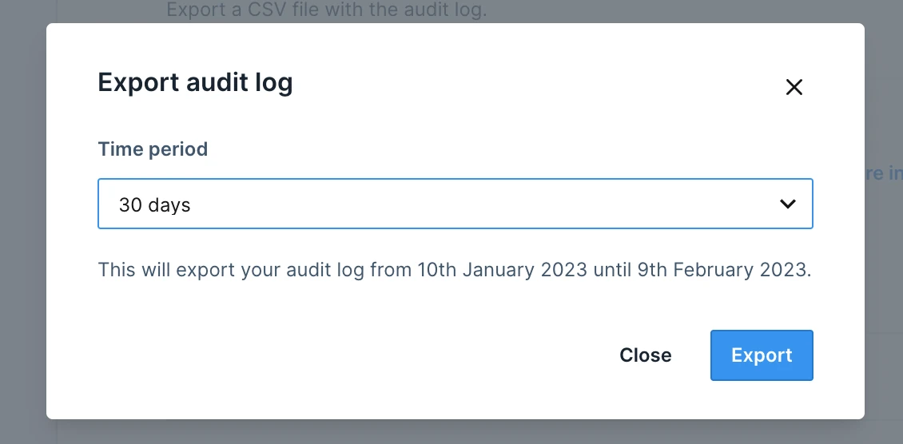
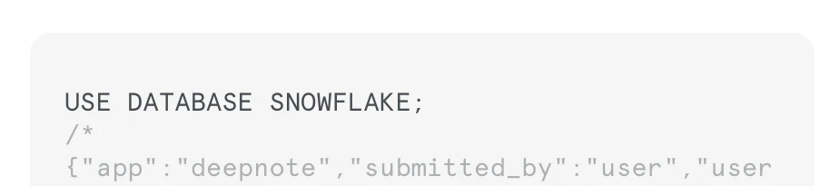

<Callout status="info">

This feature is available on the Enterprise plan.

</Callout>

Deepnote stores every user's action within a workspace, together with metadata associated with it. Workspace admins can export the audit log as a .csv file from the Settings & members > Security page Audit log section.



### Audit log API

<Callout status="info">

The audit log API is in beta. Limits may change as we learn how it is used.

</Callout>

Workspace admins on the Enterprise plan can also read the audit log programmatically with `GET https://api.deepnote.com/v2/audit-logs`. It returns the same events as the CSV export as JSON, newest first, and accepts the workspace API key as a bearer token (see [Deepnote API](/docs/deepnote-api)). The key must have been created by a workspace admin.

Use `from` and `to` (ISO 8601 timestamps) to select a window, `type` to select event types, and follow `nextPageToken` until `hasMore` is `false`. Filtering by `type` requires `from`. To load the log into your own warehouse, run the request on a schedule and pass the end of the previous window as `from`.

```
GET /v2/audit-logs?from=2026-10-29T00:00:00Z&to=2026-10-30T00:00:00Z
Authorization: Bearer INSERT_API_KEY
```

The endpoint returns up to 1,000 events per page and is limited to 10 requests per minute per workspace, counted across all of the workspace's API keys. When you hit the limit, the response is `429` with a `Retry-After` header. Every call is recorded in the audit log as an `audit_logs_export_triggered` event.

### SQL blocks audit log

When executing an [SQL block](/docs/sql-cells), Deepnote appends a SQL comment with metadata related to the context in which the query is executed. This helps administrators of a database to quickly understand when and by whom the query was executed. The metadata contains workspace, project and notebook ID, whether the query was executed by a user, scheduling or API, and a link to the project.


