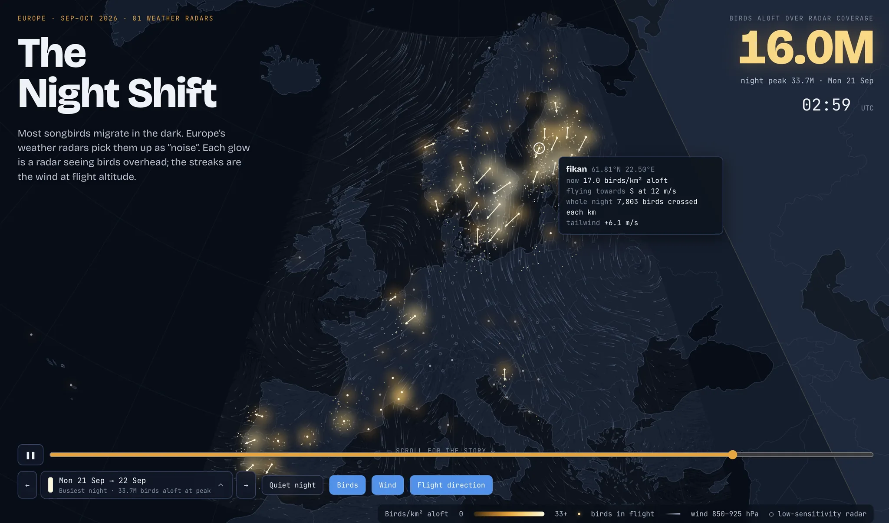
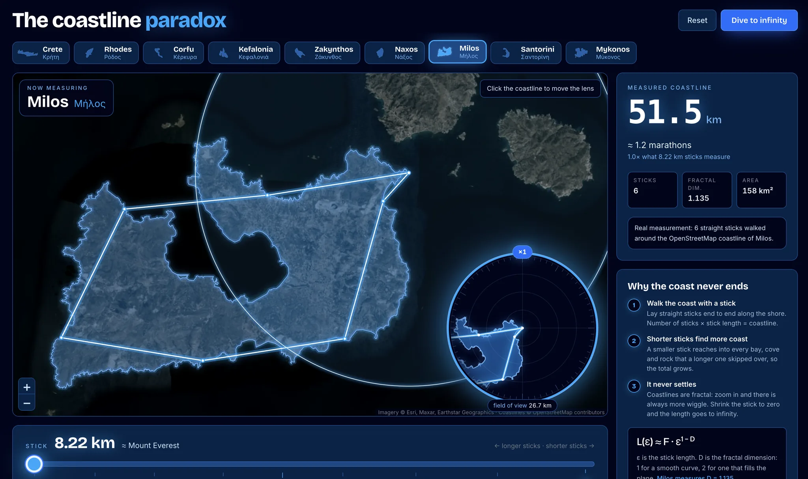

<Callout status="info">
Data app projects are in beta. This is an early version, so expect it to change, and tell us what you'd like it to do.
</Callout>

A data app project is a web app you build by chatting with [Deepnote Agent](/docs/deepnote-agent). Describe what you need, such as a sales dashboard, a data explorer, or an interactive tool, and the agent builds the app and connects it to a notebook that queries and prepares the data. Refine it in chat and share it with your team.

Data app projects replace apps published from notebook blocks, which are deprecated. For a Python app, see [Streamlit app projects](/docs/streamlit-app-projects). To put a chart or table in another tool, [embed the block](/docs/sharing-and-embedding-blocks).

## Creating a data app

1. Click **Create new** in your workspace and choose **New data app**.
2. Describe the app you want, or pick one of the suggested prompts.
3. The agent looks for data in your connected integrations and project files and builds a first version. If nothing fits, it uses clearly labeled sample data and offers to connect real data.

After your first prompt, the app opens next to the chat. Keep asking for changes, such as a new chart, another filter, or a different layout, and the agent updates the app.

## How a data app works

A data app has two parts:

- **The page:** an HTML page with its own styles and scripts, stored in `_deepnote_static/index.html`. Filtering, sorting, and charts run in the page.
- **The notebook:** runs the SQL and Python behind the app and returns the data the page needs. Queries, credentials, and heavy computation stay in the notebook, never in the page.

To see the notebook, click **Show notebook** in the top bar. Click **Show app** to go back.

### Data and refreshes

Runs are per person. Each signed-in person sees data from their own latest run of the notebook. The first time they open the app they have no run yet, so the app shows no data and asks them to run the notebook. After that, opening or reloading the app fetches their last run's results rather than running anything again. To get fresh numbers they submit the app's inputs, or use its rerun control if it has one, and the whole notebook runs again for them.

If the app is public, someone who opens it without signing in sees the results of the last run started by an editor or admin — a scheduled run included — and can rerun the app to get fresh results. This is the only case in which one person's run is what another person sees.

Running blocks in the editor doesn't change what the app shows.

### Inputs

The app's controls use the notebook's [input blocks](/docs/input-blocks). When someone changes a control and submits, the notebook runs with their values.

### AI summaries

The app can show text written by an agent block in the notebook, such as a summary of the latest numbers. Ask the agent to add one. The summary is written on each run, so it matches the data the viewer sees.

### Using data from another app

A data app can show another app's data by connecting to that app's notebook instead of copying its queries. Ask the agent to use the other app's data. People who open your app need at least **View** access to the other app's project.

## Fixing errors

After each change, the agent reloads the app, checks it for errors, and fixes them on its own. If an error is still there after two tries, it tells you what's still failing.

If the app hits an error while you're using it, a message appears above the app. Click **Fix** to let the agent fix it.

## Changing the look

New apps use a calm, Deepnote-like theme with light and dark modes. Ask the agent for another look, such as your brand's colors and fonts.

## Examples

Three data apps built on public data are in the Deepnote repository, under [`examples/data-apps`](https://github.com/deepnote/deepnote/tree/main/examples/data-apps). Each folder is one project: a notebook that downloads and prepares the data, and the page that shows it.

- **[Global ship traffic](https://github.com/deepnote/deepnote/tree/main/examples/data-apps/ship-traffic-globe)** turns six years of AIS position reports into a 3D globe and a flat map of the world's shipping lanes, down to the busiest straits and canals.

  

- **[The Night Shift](https://github.com/deepnote/deepnote/tree/main/examples/data-apps/bird-migration-europe)** shows a season of nightly bird migration over Europe, measured by weather radars, beside the wind that shapes it.

  

- **[The coastline paradox](https://github.com/deepnote/deepnote/tree/main/examples/data-apps/coastline-paradox)** walks a ruler along nine Greek islands, from tens of kilometers down to tens of metres, and plots each coastline growing as the ruler shrinks.

  

None of them need an API key, and each notebook caches its downloads in the project, so only the first run is slow. Their pages are written by hand rather than by the agent, which is how to take an app past what chat gives you: the page is yours, and the notebook still does the querying and the heavy work behind it.

For apps built on a company's own data, see [`examples/lindquett-software`](https://github.com/deepnote/deepnote/tree/main/examples/lindquett-software), five tools one fictional SaaS company runs on Deepnote.

## Publishing and sharing

A new data app is unpublished, so only editors of the project can open it. To let others use it:

1. Click **Share** in the top bar and set the app to **Published**.
2. Invite people, groups, or your workspace, and choose their access:
   - **App user:** can open and use the published app, but can't see the notebook or the app's code. New collaborators get this access by default.
   - **View:** can also open the project and see the notebook and the app's code, without changing them.
   - **Edit:** can change the app and the notebook, use the agent, and publish or unpublish the app.
3. Click **Copy link to app** and send the link.

To make the app editor-only again, set it to **Unpublished**.

Published apps open only when **Allow static file sharing in projects** is on in **Settings & members → Project settings**.

To publish from code, upload a local build with [`deepnote publish`](/docs/deepnote-cli-publish), or call
`PATCH /v2/projects/{projectId}` with `{ "dataApp": { "published": true } }` through the
[Deepnote API](/docs/deepnote-api). Send `false` to unpublish.

### Sharing an app publicly

A published app can be made public, so anyone with its link can open it, including people without a Deepnote account. Public apps are available on the Team and Enterprise plans, and only a project admin can make an app public.

Public access can be turned on only here, in the app's **Share** dialog. The [CLI](/docs/deepnote-cli-publish) and the [API](/docs/deepnote-api) can publish an app to the people with project access, but can't open it to anyone with the link: making an app public is a deliberate step someone takes in Deepnote, not something a script or a pipeline can do.

1. Click **Share** in the top bar.
2. Under **Anyone with a link to this app**, choose the access:
   - **View:** visitors see the latest saved results from runs by the app's editors and admins. Results from their later runs become public too.
   - **Execute:** visitors can also run the app with their own inputs and see their own results.
3. Click **Copy link to app** and send the link.

Visitors can't open the project or the notebook. Before you make an app public, keep in mind:

- Check the app for sensitive information. Anyone can forward the link or keep a copy of what they see.
- Visitor runs use your workspace's machines and integrations. They can read the project's files but can't change them.
- All visitors of an app share one limit on runs. A busy app asks them to try again in a few minutes.
- When **Private outputs** is on, visitors see only the results of their own runs, so an app with **View** access shows them no results.

To make the app private again, choose **Disabled**. The app also stops being public when you unpublish it.

Public apps open only when **Allow apps to be shared publicly** and **Allow static file sharing in projects** are on in **Settings & members → Project settings**. Turning off **Allow apps to be shared publicly** removes public access from every app in the workspace and keeps the apps published for collaborators.

### Embedding a public app

The link of a public app also works in an iframe on another site:

```html
<iframe
  src="https://deepnote.com/apps/your-app"
  width="100%"
  height="600"
></iframe>
```

Use the link from **Copy link to app** as the `src`. An embedded app shows a compact Deepnote top bar, and everyone uses it as a visitor, even when they are signed in to Deepnote.
