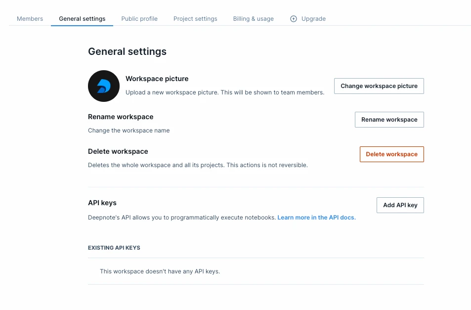

<Callout status="info">
The API is available on Team and Enterprise plans.
</Callout>

The Deepnote API lets your own code do what you would otherwise do in the editor: run a notebook with
new inputs and read its outputs, start and stop machines, keep a long-lived session for follow-up
work, export and import projects, set up integrations, and search the workspace. Use it to put
notebooks behind a product feature, wire them into a data pipeline, give an AI agent a place to
compute, or manage a workspace as code.

Every endpoint, with its parameters and responses, is listed in the
[API reference](/docs/api-reference). The guides below show how the pieces fit together.

## What you can build

| Guide                                                     | What it covers                                                                                                                      |
| --------------------------------------------------------- | ----------------------------------------------------------------------------------------------------------------------------------- |
| [Running notebooks](/docs/deepnote-api-runs)              | Run a notebook with inputs, wait for it, read outputs as JSON, list past runs, and manage schedules                                 |
| [Interactive sessions](/docs/deepnote-api-sessions)       | Keep a notebook's kernel alive between requests and submit follow-up runs or code against the same state                            |
| [Machines](/docs/deepnote-api-machines)                   | Start, stop and restart a project's machine, change its hardware, and set idle shutdown to control machine time                     |
| [Projects and integrations](/docs/deepnote-api-workspace) | Export and import projects as `.deepnote` files, create and attach integrations, find where they are used, and search the workspace |

Deepnote also uses this API itself. The [Deepnote CLI](/docs/deepnote-cli) calls it for
`run --cloud`, `schedule`, `sync` and `publish`, and the [Deepnote MCP server](/docs/deepnote-mcp)
gives AI agents the same capabilities. If one of those already does what you need, it is usually
the quicker route.

## Authentication

Create an API key in your workspace under **Settings & members → Security → API keys**.



Send the key as a bearer token with every request:

```bash
export DEEPNOTE_TOKEN="<your-api-key>"

curl https://api.deepnote.com/v2/me \
  -H "Authorization: Bearer $DEEPNOTE_TOKEN"
```

`GET /v2/me` returns the key, the user it acts as and its workspace, which is a quick way to check
that a key works before you build on it.

<Callout status="warning">
An API key acts with the access of the user who created it, across the whole workspace. Keep it in
a secret store, never in client-side code or a repository, and revoke it from the same settings
page if it is exposed.
</Callout>

## Conventions

- **Base URL:** `https://api.deepnote.com/v2`. Request and response bodies are JSON unless an
  endpoint says otherwise (project export and import use ZIP archives).
- **IDs** come from the API itself or from the editor URL. `GET /v2/projects` lists projects
  (filter with `nameContains`), `GET /v2/projects/{projectId}` lists a project's notebooks,
  integrations and files, and a `.deepnote` file records its project and notebook ids.
- **Pagination:** `GET /v2/projects`, `GET /v2/notebooks/{notebookId}/runs` and `GET /v2/audit-logs`
  take `pageSize` and `pageToken`, and return `pagination.nextPageToken` until `hasMore` is `false`.
  Other list endpoints are not paginated.
- **Errors** return `{ "message": "…" }` with a standard status code. `409` means the request
  conflicts with the current state, for example the project is suspended, a machine is in the wrong
  state, or a plan limit is reached; the message says which.
- **Rate limits** return `429` with a `Retry-After` header giving the seconds to wait.

## Apps that call the API as their viewer

A website published from a project's static files, or a hosted Streamlit app, can call the API as
the person viewing it rather than with your key. Deepnote hands the app a short-lived viewer token
that is limited to reading a notebook's inputs, starting detached runs and reading that viewer's own
runs. See [Viewer API access](/docs/deepnote-cli-publish#viewer-api-access) for websites and
[Streamlit apps](/docs/streamlit) for Python.

## Related

- [API reference](/docs/api-reference): every endpoint, parameter and response
- [Deepnote CLI](/docs/deepnote-cli): the same API from your terminal and CI
- [Running notebooks in CI](/docs/deepnote-cli-ci)
- [Deepnote MCP](/docs/deepnote-mcp): connect AI agents to your workspace
- [Scheduling](/docs/scheduling) and [Run snapshots](/docs/run-snapshots)
