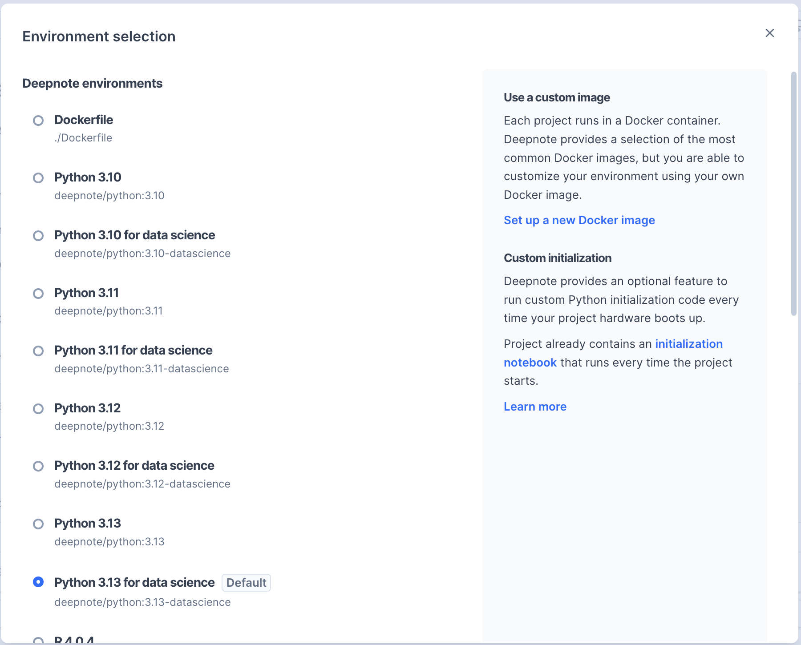

Deepnote offers a variety of preconfigured environments, all maintained by our engineering team and ready to use out of the box. These environments are primarily built on Debian Linux and the official Python repository, with Python being our primary supported language. While you can also use other languages like R or Stata, these environments have limited functionality and don't support all Deepnote features.

Default environments launch in seconds thanks to pre-warmed instances and cached images. These environments are battle-tested, used by the majority of Deepnote projects, and come with comprehensive support from our team. They include all common binary dependencies pre-installed, minimizing potential setup issues and helping you get started faster.

Our engineering team regularly updates the default environments to ensure all system components stay current, including Linux security patches and binary dependencies. However, if your project requires specific versions of system binaries or kernels, we recommend using a [custom environment](https://deepnote.com/docs/custom-environment) to maintain consistent behavior and prevent potential compatibility issues.



## Managed environments

| Environment name                   | Image tag                                                                   | Description                                                                                                                                                                                                                                               |
| ---------------------------------- | --------------------------------------------------------------------------- | --------------------------------------------------------------------------------------------------------------------------------------------------------------------------------------------------------------------------------------------------------- |
| Python                             | [deepnote/python:3.x](https://hub.docker.com/r/deepnote/python)             | This lightweight Python environment includes essential binary dependencies while letting you start with a clean slate for Python packages. It's ideal for projects that need a few specific libraries or for building custom environments on top of this. |
| Python with data science libraries | [deepnote/python:3.x-datascience](https://hub.docker.com/r/deepnote/python) | This environment comes pre-loaded with popular data science libraries, offering a ready-to-use workspace for those who want to start coding immediately without package installation.                                                                     |
| Conda                              |                                                                             | This environment comes pre-loaded with popular data science libraries via Conda, offering a ready-to-use workspace for those who prefer Conda package management.                                                                                         |
| R                                  | [deepnote/ir:x](https://hub.docker.com/r/deepnote/ir)                       | This experimental environment enables R programming within Deepnote notebooks.                                                                                                                                                                            |
| R with data science libraries      | [deepnote/ir-with-libs:x](https://hub.docker.com/r/deepnote/ir-with-libs)   | This environment comes with popular R data science libraries pre-installed.                                                                                                                                                                               |

Need something more specific? You can create [custom environments](https://deepnote.com/docs/custom-environment) tailored to your project's needs. Build your own environment with exactly the dependencies you require, then share it across your entire workspace for consistent development.

## Use the same environment outside Deepnote

The Python images are public on Docker Hub, so you can run notebooks locally or in CI on the same
libraries they get in Deepnote, which is useful for checking that a notebook still works before it is
scheduled, or for reproducing a result on your own machine. Installing `deepnote-toolkit[server]`
into the image can upgrade a few of its packages (for example Pillow), so compare `pip freeze`
before and after if a notebook depends on an exact version.

In the `-datascience` images the libraries live in a virtual environment at `/root/venv`. Activate
it, add [`deepnote-toolkit`](https://pypi.org/project/deepnote-toolkit/) and the
[Deepnote CLI](/docs/deepnote-cli), and run the notebook:

```bash
docker run --rm -v "$PWD:/work" -w /work deepnote/python:3.12-datascience bash -c '
  . /root/venv/bin/activate
  pip install -q "deepnote-toolkit[server]" deepnote-cli
  deepnote run analysis.deepnote -o json
'
```

In GitHub Actions, run the job in the image:

```yaml
jobs:
  notebooks:
    runs-on: ubuntu-latest
    container: deepnote/python:3.12-datascience
    steps:
      - uses: actions/checkout@v7
      - name: Run the notebook on Deepnote's data science libraries
        run: |
          . /root/venv/bin/activate
          pip install -q "deepnote-toolkit[server]" deepnote-cli
          deepnote run analysis.deepnote --startup-timeout 60 --block-timeout 300 -o json
```

Use the absolute `/root/venv` path: container jobs change the home directory, so `~/venv` does not
point to it. The `-datascience` images are large (a 4 GB download, about 14 GB on disk), so the
first pull takes a few minutes. See [Running notebooks in CI](/docs/deepnote-cli-ci) for exit codes, inputs and running in
Deepnote Cloud instead.
