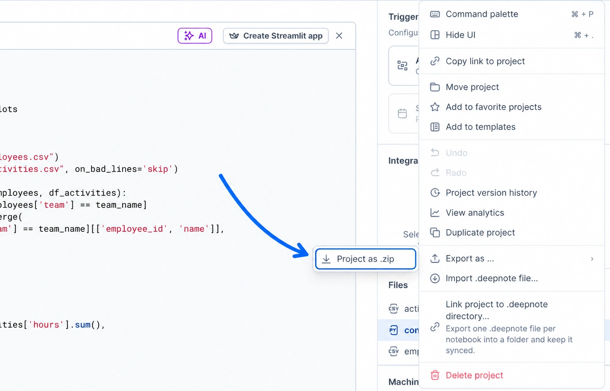

To export a project, click the ellipses (`...`) in the project toolbar, hover over **Export as ...**, and click **Project as .zip**. The downloaded file is in zip format and contains your notebooks (in `.ipynb` format) as well as your other assets.

