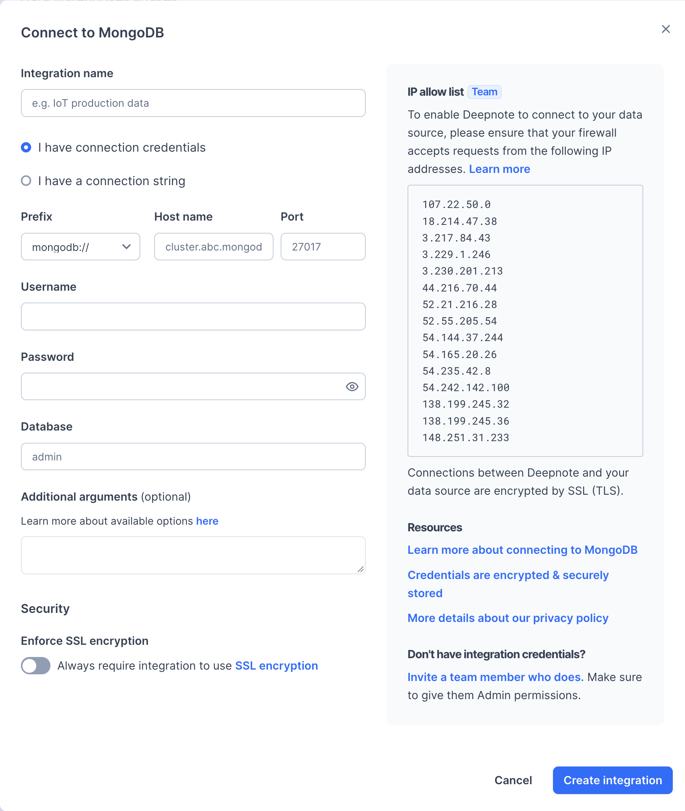

<Callout status="info">
Available on Team and Enterprise plans
</Callout>

Open **Integrations** from the workspace sidebar and select **MongoDB**. Choose **I have connection credentials** or **I have a connection string**, then enter your database connection details:



After creating the integration, connect it to your project when prompted.

### Secure connections

To connect through SSH, use an [SSH tunnel integration](/docs/securing-connections#ssh-tunnel-integration).

#### Troubleshooting SSH connections for MongoDB

If you are encountering the following error

```
Could not reach any servers in X
```

try adding `directConnection=true` to the connection URL.
