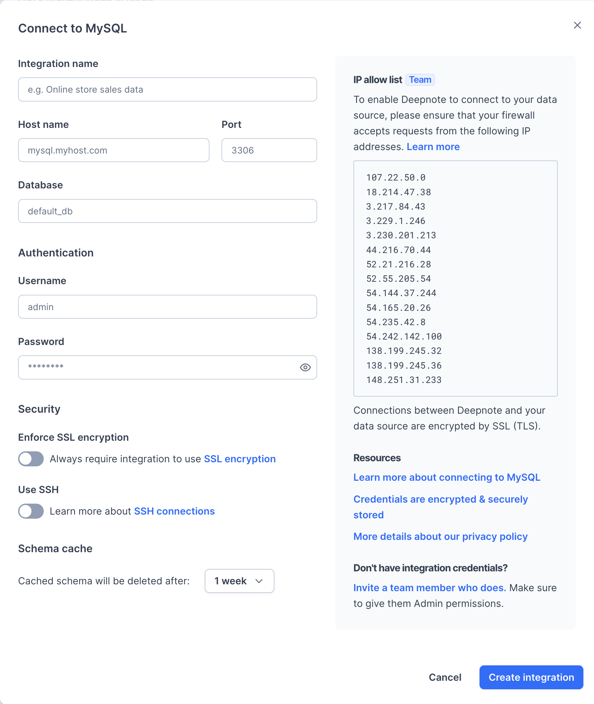

Open **Integrations** from the workspace sidebar, select **MySQL** or **MariaDB**, and enter your database connection details:

After creating the integration, connect it to your project when prompted. You can also select it when adding a SQL block.

### Usage

Click **SQL** in the toolbar below the notebook and select your integration to add a [SQL block](/docs/sql-cells).

### Secure connections

Use **Enforce SSL encryption** or **Use SSH** in the connection form to configure [secure connections](/docs/securing-connections).
