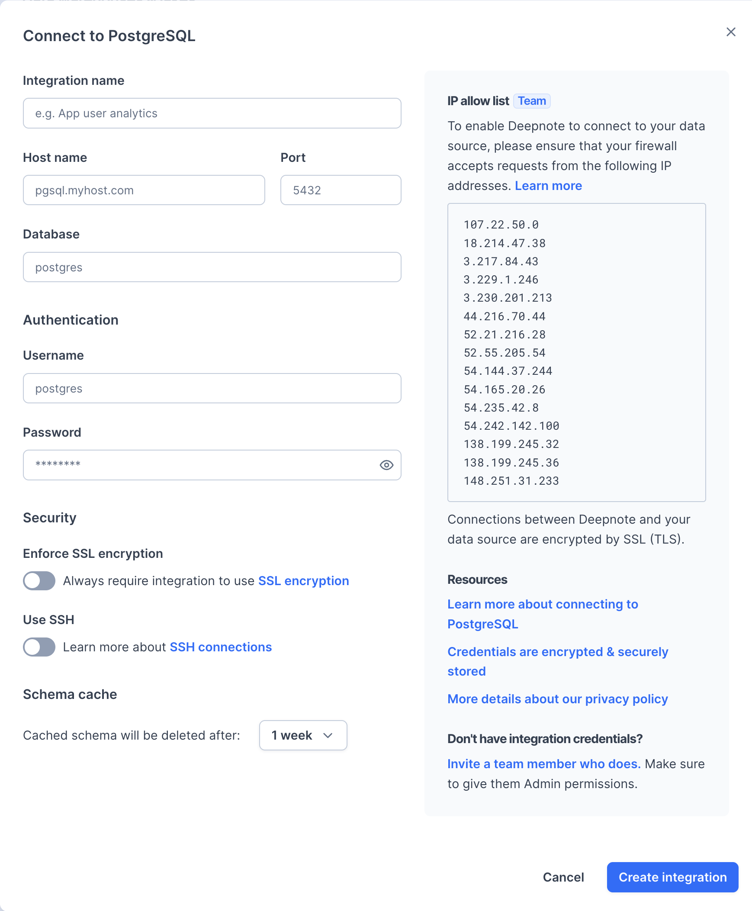
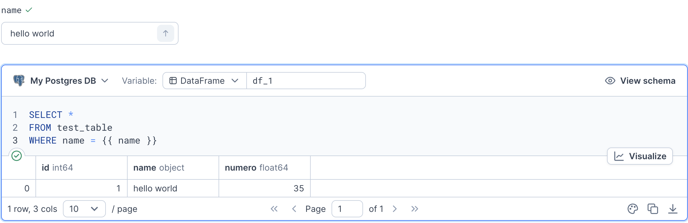

## Setup

Open **Integrations** from the workspace sidebar, select **PostgreSQL**, and enter your database connection details:



After creating the integration, connect it to your project when prompted. You can also select it when adding a SQL block.

### Authorizing Deepnote's IP addresses for security reasons

<Callout status="info">
If your connection is protected, you might need to add Deepnote's IP addresses to your allowlist. [Read more here](/docs/securing-connections#authorizing-deepnotes-ip-addresses)
</Callout>

## Usage

To query your PostgreSQL database, click **SQL** in the toolbar below the notebook and select your integration. This adds a [SQL block](/docs/sql-cells).



Use a [text input block](/docs/input-blocks) to pass a value into your SQL query. In this example, `{{ name }}` uses the input value `hello world`.

## Advanced usage

To connect from Python, use the environment variables generated from your integration name:

- `<INTEGRATION_NAME>_HOST`
- `<INTEGRATION_NAME>_DATABASE`
- `<INTEGRATION_NAME>_PORT`
- `<INTEGRATION_NAME>_USER`
- `<INTEGRATION_NAME>_PASSWORD`

Replace `MY_INTEGRATION` below with the prefix generated from your integration name. For example, an integration named `My Postgres DB` uses `MY_POSTGRES_DB`.

```python
import psycopg2
import os

try:
    connection = psycopg2.connect(
        user=os.environ["MY_INTEGRATION_USER"],
        password=os.environ["MY_INTEGRATION_PASSWORD"],
        host=os.environ["MY_INTEGRATION_HOST"],
        port=os.environ["MY_INTEGRATION_PORT"],
        database=os.environ["MY_INTEGRATION_DATABASE"])

    with connection.cursor() as cursor:
        cursor.execute("SELECT version();")
        record = cursor.fetchone()
        print("You are connected to - ", record)

except (Exception, psycopg2.Error) as error:
    print ("Error while connecting to database", error)
```

Use `connection.cursor()` to run further queries. For pandas, create a SQLAlchemy engine so `read_sql_query` uses a supported connection type:

```python
import pandas as pd
from sqlalchemy import URL, create_engine

url = URL.create(
    "postgresql+psycopg2",
    username=os.environ["MY_INTEGRATION_USER"],
    password=os.environ["MY_INTEGRATION_PASSWORD"],
    host=os.environ["MY_INTEGRATION_HOST"],
    port=int(os.environ["MY_INTEGRATION_PORT"]),
    database=os.environ["MY_INTEGRATION_DATABASE"],
)
engine = create_engine(url)

with engine.connect() as connection:
    df = pd.read_sql_query("SELECT * FROM users", connection)

df
```

### Secure connections

Use **Enforce SSL encryption** or **Use SSH** in the connection form to configure [secure connections](/docs/securing-connections).
