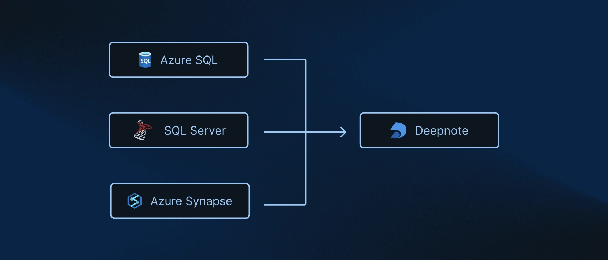

<Callout status="info">
Available on Team and Enterprise plans
</Callout>

Use the SQL Server integration to query SQL Server, Azure SQL, or Azure Synapse from Deepnote's [SQL blocks](/docs/sql-cells).

Each SQL block uses its selected integration. When switching databases, check that your query uses tables and SQL features available in the target database.

### How to connect to SQL Server (or Azure SQL, or Azure Synapse)

Open **Integrations** from the workspace sidebar and select **Microsoft SQL Server**. Enter an integration name and the connection details below, then click **Create integration**.

To create the integration, you'll need a few things:

- **Hostname**: The hostname of the server you are trying to connect to. Check out [this section](https://docs.microsoft.com/en-us/sql/connect/jdbc/building-the-connection-url?view=sql-server-ver16) of Microsoft's docs for more details.
- **Port**: The port on the server of interest you are trying to connect to. Usually, the default is port 1433. Take a look at the [Microsoft SQL Server docs](https://docs.microsoft.com/en-us/sql/connect/jdbc/building-the-connection-url?view=sql-server-ver16) for more details.
- **Username**: Your username. More in Microsoft's docs [here](https://docs.microsoft.com/en-us/sql/t-sql/functions/user-name-transact-sql?view=sql-server-ver16).
- **Password**: The password for the specified username.
- **Database**: The name of the database you would like to connect to.

<Callout status="info">

If your connection is protected, you might need to add Deepnote's IP addresses to your allowlist. [Read more here](/docs/securing-connections#authorizing-deepnotes-ip-addresses).

</Callout>

### How to use

After creating the integration, connect it to your project when prompted. Click **SQL** in the toolbar below the notebook and select your SQL Server integration to add a SQL block. To use an existing SQL block, choose the integration from the block's connection selector.

Query results are saved in the DataFrame variable named in the SQL block.

### Next steps

Explore the [A/B testing template](https://deepnote.com/launch?template=A/B%20Testing) for more examples of SQL blocks.

### Secure connections

Use **Use SSH** in the connection form to configure an [SSH tunnel](/docs/securing-connections#using-ssh-to-connect-to-your-data). Deepnote attempts to encrypt the connection with SSL (TLS) when available.
