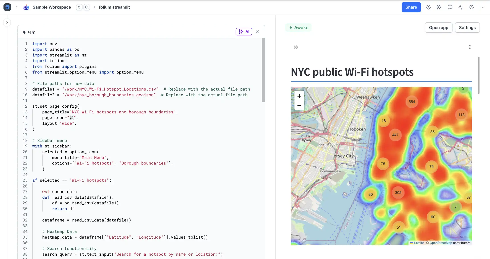
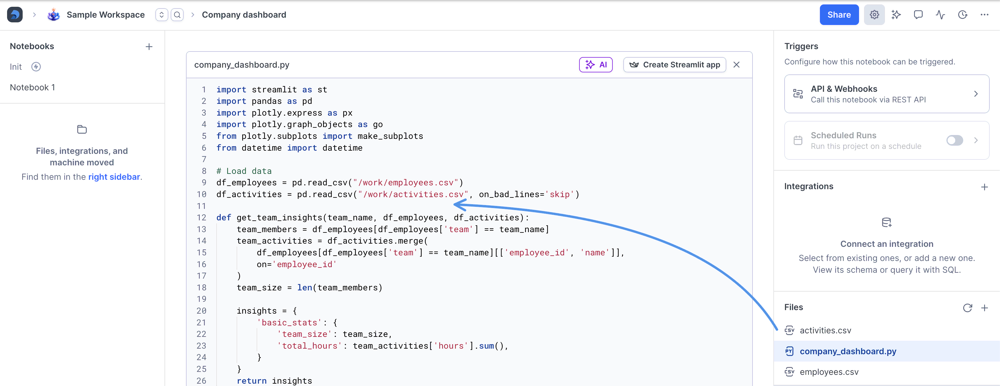

Streamlit is a popular open-source Python framework for creating interactive dashboards and data apps. With Deepnote's native Streamlit support, you can host and share these apps directly in your workspace. All you need is your Python script - Deepnote handles the rest.

Get started by exploring our [example apps](https://deepnote.com/explore#streamlit-apps) or watch our quick guide:

<Embed url='https://www.loom.com/embed/e4bb3ea481e642d288733ea0c1c275f5?hide_owner=true&hide_share=true&hide_title=true&hideEmbedTopBar=true' />

## Creating an app

There are two ways to get started with Streamlit in Deepnote:

1. Drop in existing scripts. Add your `.py` file to your project's **Files** panel in the right sidebar. Open the file and click **Create Streamlit app** to deploy it.
2. Start from scratch. Create a new `.py` file and write your Streamlit code directly in Deepnote - from simple buttons to complex interactive elements. When ready, click the **Create Streamlit app** button in the upper right corner to deploy.

Once deployed, use the **Open app button** to see your app in its full shared state.



## App status

Your project's hardware serves your Streamlit apps. The indicator in the upper left corner of the app preview shows the current state:

- `Awake`: The app is deployed and running, so visitors can interact with it.
- `Sleeping`: The project hardware is inactive. Refresh the app to wake it up.
- `Waking up`: The project hardware is starting and the app is not yet available.
- `Going to sleep`: The app is becoming unavailable as the project hardware shuts down.

## Editing an app

When you make changes to your app's code, your updates will be reflected immediately in the live app. This means anyone viewing your app will see these changes as they happen.

## Sharing an app

To share your deployed app, click **Settings** and **Copy link**.

Important: Your app inherits your project's sharing settings. To make your app visible to people outside your Deepnote workspace, go to Share in the project header and set link sharing to 'View'. This allows others to view your app and project content but prevents them from making any edits.

## Using data

Streamlit apps often need data to visualize. Deepnote's notebook environment is perfect for preparing datasets for your Streamlit dashboards:

1. Create notebooks to process your data using our SQL integrations and AI assistance
2. Save your results (commonly as `.csv` files)
3. Reference these files in your Streamlit script



Need to update your data regularly? Take advantage of [notebook scheduling](https://deepnote.com/docs/scheduling) to automate your data preparation.

## Using integrations

It is possible to use integrations connected to your project from a Streamlit app.

For storage integrations, such as S3, Google Drive, or Shared Datasets, you can access the files in Python the same way you would in notebooks.

For integrations that rely on specific environment variables (such as database integrations like Snowflake, Postgres, or BigQuery), you need to include a specific code snippet at the beginning of your Streamlit app to populate the app with the required environment variables:

```python
import deepnote_toolkit
deepnote_toolkit.set_integration_env()
```

An example app that connects to the demo Snowflake integration and renders a DataFrame could look like this:

```python
import streamlit as st
import os
import snowflake.connector
import pandas as pd

import deepnote_toolkit
deepnote_toolkit.set_integration_env()

st.header('Snowflake table')

conn = snowflake.connector.connect(
    account=os.environ["_DEMO__SNOWFLAKE_ACCOUNTNAME"],
    user=os.environ["_DEMO__SNOWFLAKE_USERNAME"],
    password=os.environ["_DEMO__SNOWFLAKE_PASSWORD"],
    database=os.environ["_DEMO__SNOWFLAKE_DATABASE"],
    role=os.environ["_DEMO__SNOWFLAKE_ROLE"],
)

query = f"SELECT * FROM DEEPNOTE.DEMO.COMPANIES"
df = pd.read_sql(query, conn)
conn.close()

st.dataframe(df)
```

### Per-viewer authentication with OAuth integrations

If your integration uses a federated authentication method (Snowflake OAuth, Snowflake with Okta, Snowflake with Azure AD, BigQuery with Google OAuth, or Trino OAuth), the static environment variables shown above are not populated, because each viewer of the app authenticates with their own credentials rather than reusing the project owner's.

Use the helpers in `deepnote_toolkit.streamlit_data_apps` to obtain a database client scoped to the current viewer.

A Snowflake app that connects via Snowflake OAuth and renders a DataFrame:

```python
import streamlit as st
import pandas as pd
from deepnote_toolkit.streamlit_data_apps import get_snowflake_connection

INTEGRATION_ID = "<paste-integration-uuid-here>"

st.header('Snowflake table')

conn = get_snowflake_connection(INTEGRATION_ID)
df = pd.read_sql("SELECT * FROM DEEPNOTE.DEMO.COMPANIES", conn)
conn.close()

st.dataframe(df)
```

A BigQuery app that connects via Google OAuth and renders a DataFrame:

```python
import streamlit as st
from deepnote_toolkit.streamlit_data_apps import get_bigquery_client

INTEGRATION_ID = "<paste-integration-uuid-here>"

st.header('BigQuery table')

client = get_bigquery_client(INTEGRATION_ID)
df = client.query("SELECT * FROM `bigquery-public-data.usa_names.usa_1910_current` LIMIT 100").to_dataframe()

st.dataframe(df)
```

You can find the integration UUID in the URL of the integration's settings page in your workspace.

The first time a viewer opens an app that uses an OAuth integration they have not authenticated yet, the helper renders an **Authenticate &lt;integration name&gt;** button that opens the same OAuth flow used by notebooks and published apps. After completing the sign-in, they reload the app and the query runs with their identity. Snowflake queries automatically use each viewer's username and (for Okta-mapped roles) their custom-attribute role.

If you need lower-level control, `get_federated_auth_token(integration_id)` returns the raw `{integrationType, accessToken, connectionParams}` payload, and `prompt_federated_auth(integration_id)` renders the authentication prompt without opening a connection.

## Running a notebook from your app

A Streamlit app can use a notebook as its backend. The notebook keeps the SQL, credentials and heavy
work; the app turns the notebook's [input blocks](/docs/input-blocks) into a form, runs the notebook
with the viewer's values and shows what it returns. Each run is started as the current viewer, so it
is subject to their Deepnote permissions: they need access to the project and permission to execute
it. Inside the run, queries use whatever credentials the integration holds. For a shared
integration that is the stored connection, so the app can return data the viewer has no direct
access to in the source system. Use an
[OAuth integration](#per-viewer-authentication-with-oauth-integrations) when queries must run as the
viewer in the database too.

Compared with exporting a CSV on a schedule, viewers get fresh results for exactly the values they
picked, and you keep one notebook as the source of truth instead of a notebook plus a copy of its
logic in the app.

```python
import streamlit as st
from deepnote_toolkit.notebooks import DeepnoteDocument, RunnerError
from deepnote_toolkit.streamlit import StreamlitCloudRunner, render_inputs

notebook_id = "your-notebook-id"
document = DeepnoteDocument.load("report.deepnote", notebook_id=notebook_id)
runner = StreamlitCloudRunner(notebook_id)

values = render_inputs(document.inputs, st.sidebar)

if st.button("Run"):
    try:
        result = runner.run(values)
        if not result.success:
            st.error(result.error or "The run failed.")
        elif result.snapshot_status == "pending":
            st.info("The run finished, but its outputs are not available yet.")
        elif (table := result.first_dataframe()) is not None:
            st.dataframe(table.records(include_index=False))
        else:
            st.write(result.text())
    except RunnerError as error:
        st.error(str(error))
```

To set it up:

1. Export the notebook as a `.deepnote` file and add it to the project's files next to the app
   script. The app reads the input definitions from it.
2. In the Streamlit app's settings, under **API access**, turn on **Allow API access for all
   Streamlit apps in this project**. Only editors can change it.
3. Share the app with the people who should use it. Viewers must be signed in and have access to the
   project.

These helpers ship in `deepnote-toolkit` 2.9.0 and later.

### What the helpers do

- **`render_inputs`** draws a Streamlit widget for each input block (text, select, slider,
  checkbox, date and date range) with the notebook's saved values as defaults, and returns the values
  to run with. A select with nothing chosen, or a date range with only one end picked, is left out,
  so the run uses the notebook's saved value; a text or date field the viewer clears runs as empty.
  File inputs appear as a text path; the helper does not upload files.
- **`StreamlitCloudRunner.run`** starts a detached run in Deepnote as the current viewer, waits for it
  (up to `timeout`, 600 seconds by default) and returns its outputs. It never falls back to your own
  token: if the viewer's credentials are not available, the call fails. Call it from the Streamlit
  script itself, not from a worker thread.
- **Results** give you `result.text()` for text output and `result.first_dataframe()` for the first
  table. Tables arrive as a preview page, so check `row_count` and `is_truncated` before treating one
  as complete.
- **Storage** is read-only by default: the notebook can read the project's files but not change them.
  Pass `storage_mode="read_write"` when it needs to write.
- **Drift check.** `runner.info().matches_inputs(document.inputs)` tells you whether the deployed
  notebook's inputs still match the `.deepnote` file the app was built from.

### Developing locally

Run the same app on your machine against Deepnote by opting into your own API key:

```python
import os

runner = StreamlitCloudRunner(notebook_id, local=True, token=os.environ["DEEPNOTE_TOKEN"])
```

When the app runs in Deepnote, `local=True` and the token are ignored and the viewer's credentials
are used. `DeepnoteDocument.load("report.snapshot.deepnote")` loads saved outputs from a
[run snapshot](/docs/run-snapshots), so you can build the layout without running anything.

### Other API calls as the viewer

`deepnote_toolkit.streamlit.current_user_api_credentials()` returns the viewer's short-lived token and
the API origin it is valid for. Viewer tokens are limited to the run loop: reading a notebook's
inputs, starting detached runs, reading the viewer's own runs and their
[app data](/docs/deepnote-api-runs). Outside Streamlit, use
`DeepnoteCloudRunner` from `deepnote_toolkit.notebooks` with an API key.

To build the same kind of app as a website instead of in Python, see
[Viewer API access](/docs/deepnote-cli-publish#viewer-api-access).

## Customizing app environment

Your Streamlit app shares its environment with your project. If you need to add specific Python libraries you can do so by:

- creating an [**Init** notebook](https://deepnote.com/docs/installing-dependencies#2-initialization-script-init-notebook). Every time your Streamlit app starts up, the Init notebook will run before and install the dependencies from your `requirements.txt` file.
- creating a [custom environment](https://deepnote.com/docs/custom-environment) for your project with all the required dependencies.
