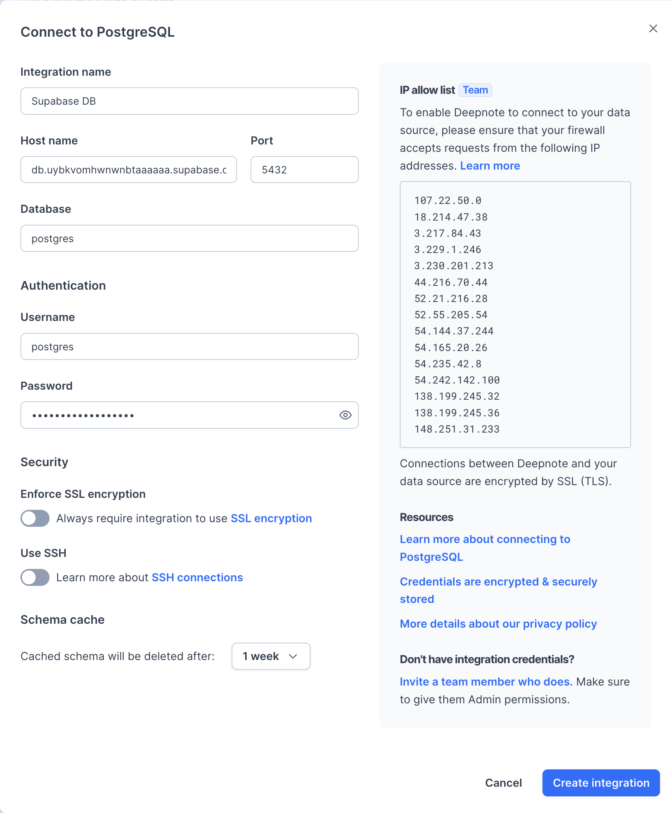
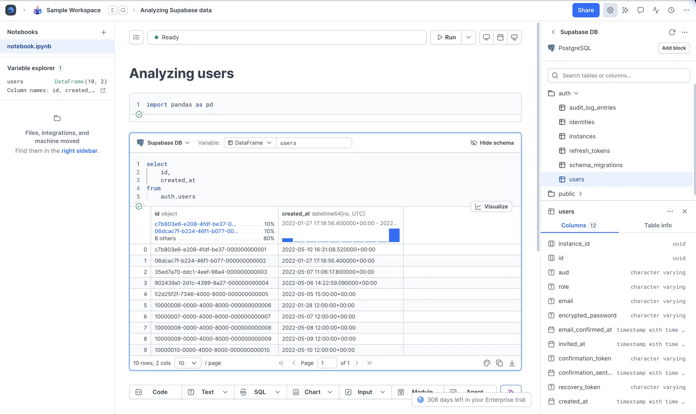

Connect your Supabase Postgres database to Deepnote to query data with SQL and analyze it with Python.

[Supabase](https://supabase.com/) is an open source Firebase alternative. Start your project with a Postgres Database, Authentication, instant APIs, Realtime subscriptions and Storage.

## Setup

### Step 1: Create a Supabase project

Go to [supabase.com](https://supabase.com/) and create a free account, and start a new project.

### Step 2: Get your database credentials ready

In your Supabase project, click **Connect** and choose a connection method. Use its host, database, port, and user with your database password. Keep all values from the same connection method.

If your network requires IPv4, use the **Session pooler** or a direct connection with the IPv4 add-on. See [Supabase's connection guide](https://supabase.com/docs/guides/database/connecting-to-postgres) for the current options.

### Step 3: Create a Postgres integration in Deepnote

Open **Integrations** from the workspace sidebar and select **PostgreSQL**. Enter your connection details from the previous step, then click **Create integration**. The screenshot uses sample direct-connection values.

### Step 4: Connect a project and query your data

After creating the integration, connect it to your project when prompted. You can also click **SQL** below the notebook and select the integration. This lets you:

- Insert and execute SQL blocks in your notebook
- Browse the schema with **View schema** in the SQL block

## Use cases

### Exploratory data analysis

Use SQL and Python to explore your data, such as cumulative user counts or the popularity of authentication providers. Create charts, forecasts, or dashboards and organize them in your data workspace.

### Sharing reports

Share your Deepnote projects with colleagues to discuss results, get comments, or ask for help with code.

### Scheduled notebooks

Use [scheduled notebooks](/docs/scheduling) to run an ETL pipeline or a regular cleanup job.

## Resources

Learn more about [Supabase](https://supabase.com) or read its [documentation](https://supabase.com/docs/)
