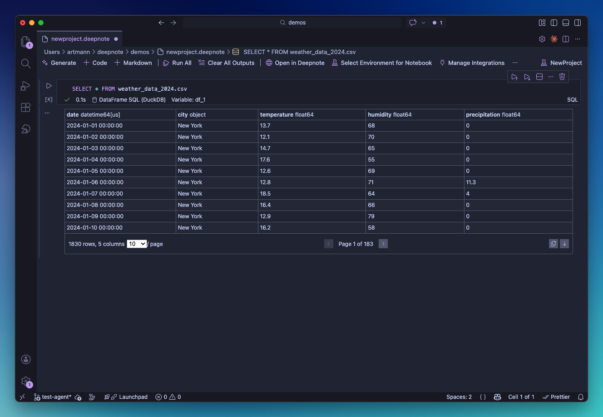

# Deepnote extension for VS Code, Cursor, Windsurf, and Antigravity

A powerful extension for [VS Code](https://code.visualstudio.com/), [Cursor](https://cursor.sh/), [Windsurf](https://windsurf.ai/), and [Antigravity](https://antigravity.google/) that brings Deepnote notebook capabilities directly into your favorite AI-native code editor. Work with slick AI notebooks featuring SQL blocks, database integrations, and reactive blocks.

**Available on:**

- [VS Code Marketplace](https://marketplace.visualstudio.com/items?itemName=Deepnote.vscode-deepnote)
- [Open VSX Registry](https://open-vsx.org/extension/Deepnote/vscode-deepnote) (for Cursor, Windsurf, and other VS Code compatible editors)
- [GitHub Repository](https://github.com/deepnote/vscode-deepnote)

The Deepnote extension provides:

- **Native `.deepnote` file support** - Open and edit Deepnote notebooks, organized by project in the Deepnote explorer
- **Block execution** - Run code, SQL, chart, big number, input and button blocks
- **Agent blocks** - Let an AI agent write and run code in the notebook from a prompt
- **Database integrations** - Query Snowflake, BigQuery, Postgres and more from SQL blocks, configured in the editor or in a `.deepnote.env.yaml` file shared with the [Deepnote CLI](/docs/deepnote-cli)
- **Rich outputs** - Display DataFrames, plots, and visualizations
- **IntelliSense** - Code completion for Python, and table and column names in SQL
- **Git-friendly files** - Outputs are kept in separate snapshot files, so `.deepnote` files diff cleanly
- **Local execution** - Use your own Python interpreter, with init notebooks and `requirements.txt` installed for you
- **Ready for coding agents** - Cursor, GitHub Copilot, Windsurf and Antigravity learn the Deepnote format automatically
- **One-click deploy** - Open a notebook in Deepnote Cloud to share it, schedule it or run it on cloud CPU/GPU machines

## Installation

### From marketplace

1. **Open your editor**
   - Launch VS Code, Cursor, Windsurf, or Antigravity

2. **Open Extensions View**
   - Click Extensions icon in sidebar (Ctrl/Cmd + Shift + X)
   - Or go to View → Extensions

3. **Search for Deepnote**
   - Type "Deepnote" in the search box
   - Find "Deepnote" by Deepnote

4. **Install**
   - Click "Install" button
   - Wait for installation to complete
   - Reload your editor if prompted

### From command line

```bash
# Install using CLI
code --install-extension deepnote.vscode-deepnote  # VS Code
cursor --install-extension deepnote.vscode-deepnote  # Cursor
windsurf --install-extension deepnote.vscode-deepnote  # Windsurf
antigravity --install-extension deepnote.vscode-deepnote  # Antigravity
```

### Verify installation

1. Open Command Palette (Ctrl/Cmd + Shift + P)
2. Type "Deepnote"
3. You should see Deepnote-related commands

## Features

### Projects and notebooks

The **Deepnote** view in the activity bar lists the `.deepnote` files in your workspace, grouped by
project. From it you can create a project or a notebook, add a notebook to a project, and rename,
duplicate or delete notebooks. **Import Notebook** brings in `.deepnote` files and Jupyter `.ipynb`
notebooks, converting the latter to Deepnote format.

Each notebook is its own `.deepnote` file, and notebooks of the same project sit next to each other
as sibling files. Opening an older file that holds several notebooks offers to split it into one file
per notebook. The status bar shows the active notebook; click it to copy its notebook and project
details.

### Block execution

Deepnote supports a wide variety of blocks including:

- **Code blocks** - Python code execution
- **SQL blocks** - Query databases with built-in connections
- **Markdown blocks** - Rich text documentation
- **Text blocks** - Paragraphs, headers, lists, and other formatted text
- **Charts** - Data visualizations
- **Input blocks** - Interactive widgets like text inputs, date pickers, number inputs, and select dropdowns

You can run a single block by clicking the play button or pressing Shift + Enter. The extension also provides controls to clear outputs and remove all execution results.

**Keyboard shortcuts:**

| Action   | Windows/Linux | macOS          |
| -------- | ------------- | -------------- |
| Run cell | Shift + Enter | Shift + Return |

### Agent blocks

An agent block holds a prompt instead of code. Add one with **Add Agent Block** (the robot button in
the notebook toolbar), describe what you want, such as _"chart monthly revenue by region and explain
the trend"_, and run it. The agent reads the rest of the notebook, adds and runs code and Markdown cells
below the block, and checks their results until it is done.

- The cells it adds are marked **Ephemeral** and are not saved to the `.deepnote` file. Running the
  block again replaces them; **Clear ephemeral blocks** on the block removes them.
- Choose the model from the agent block's status bar.
- The extension asks for an OpenAI API key the first time and keeps it in the editor's secret
  storage. Change it with **Deepnote: Set OpenAI API Key** or **Deepnote: Clear OpenAI API Key**.
- A notebook can have one agent block.

The extension runs agent blocks with OpenAI models. It reads `OPENAI_BASE_URL` from the editor's
environment, and `OPENAI_MODEL` when the block's model is `auto`. To use Claude or an
OpenAI-compatible endpoint, run the notebook with the
[Deepnote CLI](/docs/deepnote-cli-agent-blocks).

### Rich output display

The extension displays a wide variety of output types including text output from stdout and stderr, interactive DataFrame tables, plots from matplotlib, seaborn, and plotly, images in PNG, JPEG, and SVG formats, HTML content, pretty-printed JSON and dictionaries, and formatted error tracebacks.

### Integrations

Integrations allow you to connect to data sources and other tools. To manage integrations, click "Manage integrations" in the top bar or use the "Deepnote: Manage integrations" command.

**Supported data sources:**

- [ClickHouse](/docs/clickhouse)
- [Amazon Redshift](/docs/amazon-redshift)
- [Amazon Athena](/docs/amazon-athena)
- [Google BigQuery](/docs/google-bigquery)
- [Snowflake](/docs/snowflake)
- [Databricks](/docs/databricks)
- [Dremio](/docs/dremio)
- [Trino](/docs/trino)
- [MongoDB](/docs/mongodb)
- [PostgreSQL](/docs/postgresql)
- [MySQL](/docs/mysql)
- [MariaDB](/docs/mysql)
- [Microsoft SQL Server](/docs/sql-server)
- [Google AlloyDB](/docs/google-alloydb)
- [Google Cloud Spanner](/docs/google-spanner)
- [Materialize](/docs/materialize)
- [MindsDB](/docs/mindsdb)

Your credentials are stored encrypted. We also support enforcing SSL connections and SSH tunnels for secure access.

#### Integrations from a file

Besides the encrypted storage behind **Manage integrations**, the extension reads integrations from a
`.deepnote.env.yaml` file in the notebook's folder or the workspace root. Its `env:` references
resolve against a `.env` file and your environment, so credentials stay out of the YAML. This is the
same file the [Deepnote CLI](/docs/deepnote-cli) uses: `deepnote integrations pull` downloads your
workspace's integrations into it, and a notebook then runs the same way in the editor, in the terminal
and in CI.

When the file or a stored integration changes, the extension updates the running kernel without a
restart. Turn file loading off with the `deepnote.integrations.envFile.enabled` setting.

#### Using integrations

Once you've created an integration, you can query it from any SQL block in your projects. In a SQL block, click the "Data source" dropdown at the bottom of the block to choose between "DataFrame SQL" or one of your configured integrations.

For BigQuery and Snowflake, you can query cloud warehouses locally using OAuth (federated auth): the extension connects through an OAuth proxy so your queries run against those warehouses from your machine. Some other authentication methods (such as IAM roles) remain available only on [Deepnote Cloud](https://deepnote.com).

### IntelliSense and code completion

The extension provides comprehensive IntelliSense features including auto-completion for Python code, function signatures with documentation, import suggestions, variable inspection, and type hints. When writing SQL, you also get autocompletion for database table and column names. IntelliSense triggers automatically as you type and pause, or you can manually invoke it by pressing Ctrl/Cmd + Space.

### Mixing Python and SQL

One of the things that makes you super productive in a Deepnote notebook is the ability to switch seamlessly between SQL and Python.

#### SQL results as DataFrames

When you run a SQL block, a DataFrame with the query results is automatically created. You can configure the variable name in the "Variable" input at the bottom of the SQL block, then access it in your Python code blocks:

```sql
SELECT
    category,
    SUM(revenue) as total_revenue
FROM
    sales
WHERE
    year = 2024
GROUP BY
    category
ORDER BY
    total_revenue DESC
```

```python
import matplotlib.pyplot as plt

plt.figure(figsize=(10, 6))
plt.bar(df_1['category'], df_1['total_revenue'])
plt.xlabel('Category')
plt.ylabel('Revenue ($)')
plt.title('2024 Revenue by Category')
plt.xticks(rotation=45)
plt.tight_layout()
plt.show()
```

#### Query DataFrames with SQL

You can use the "DataFrame SQL" data source in SQL blocks (which uses DuckDB under the hood) to query DataFrames that have been defined in earlier code blocks:

```python
import pandas as pd

customers = pd.read_csv('customers.csv')
```

```sql
SELECT
    *
FROM
    customers
WHERE
    age >= 30
ORDER BY
    average_spend
```

#### Query files with SQL

You can also query local files like CSV, Parquet, or JSON directly from a SQL block without loading them into a DataFrame first. Select "DataFrame SQL" as the data source (which uses DuckDB under the hood) and reference the file path in your query:

```sql
SELECT * FROM sales_data.csv WHERE region = 'Europe'
```

File paths are relative to the folder where your `.deepnote` file is located. DuckDB supports reading from CSV, Parquet, JSON, and [other formats](https://duckdb.org/docs/data/overview).



#### Jinja templating in SQL

SQL blocks support Jinja-style templating with `{{ variable }}` syntax, letting you reference Python variables directly in your queries:

```python
selected_year = 2024
min_revenue = 10000
categories = ['Electronics', 'Software', 'Services']
```

```sql
SELECT
    category,
    SUM(revenue) as total_revenue
FROM
    sales
WHERE
    year = {{ selected_year }}
    AND revenue >= {{ min_revenue }}
    AND category IN {{ categories }}
GROUP BY
    category
ORDER BY
    total_revenue DESC
```

### Outputs and snapshots

Outputs are saved to separate snapshot files in a `snapshots` folder next to the notebook, not into
the `.deepnote` file itself. The notebook file stays small and readable, so it diffs and merges
cleanly in Git, and you can choose whether to commit the outputs. When you reopen a notebook, its
latest outputs are loaded from the snapshot. **Deepnote: Disable Snapshots** (or the
`deepnote.snapshots.enabled` setting) stores outputs in the `.deepnote` file instead. See
[Working with notebooks in Git](/docs/deepnote-cli-git).

### Variables

The **Deepnote Variables** panel in the Deepnote view lists the variables in the notebook's running
kernel, so you can check what a block defined without printing it.

### AI coding agents

When the extension starts a notebook, it installs Deepnote's agent skills into the workspace for the
editor's assistant: Cursor, Windsurf, Antigravity, or GitHub Copilot in VS Code. The skills teach
the assistant the `.deepnote` format and the Deepnote CLI, so it can write notebooks and check its
work with `deepnote lint` and `deepnote run`. The CLI comes bundled with the extension, so the skills
install nothing into your Python environment.

In VS Code, GitHub Copilot's agent mode also gets tools to prepare a notebook's kernel and to list
and install packages in it.

To give an assistant access to your Deepnote Cloud workspace as well, connect the
[Deepnote MCP server](/docs/deepnote-mcp).

### Open in Deepnote

**Open in Deepnote** in the notebook toolbar, or in the editor's context menu for a `.deepnote` file,
uploads the file to Deepnote Cloud and opens it in your browser. Use it to share a notebook with your
team, collaborate on it in real time, [schedule](/docs/scheduling) it, or run it on bigger CPU and
GPU machines.

### Exporting to different formats

You can export individual notebooks to the Jupyter notebook format. To export a notebook:

1. Right-click a notebook in the Explorer
2. Select "Export Notebook..."

This allows you to share your work in the widely-supported `.ipynb` format.

### Native .deepnote file support

The extension automatically associates `.deepnote` files with the notebook interface, providing YAML syntax highlighting when viewing the raw file and a structured notebook view for editing. You can work in three different view modes: Notebook View for interactive editing and execution, Source View for raw YAML editing, or Split View to see both views side-by-side.

**Viewing raw YAML:**

To view the raw `.deepnote` file structure:

1. Right-click the `.deepnote` file in the File Explorer
2. Select "Open With..."
3. Choose "Text Editor"

This opens the file in VS Code's standard text editor with YAML syntax highlighting, allowing you to inspect or edit the underlying file structure directly.

## Configuration

### Extension settings

On macOS, access the extension settings through Code → Preferences → Settings. On Windows or Linux, use File → Preferences → Settings. You can also press Ctrl/Cmd + `,`. Then search for "Deepnote".

| Setting                                 | Default        | What it does                                                                                                            |
| --------------------------------------- | -------------- | ----------------------------------------------------------------------------------------------------------------------- |
| `deepnote.snapshots.enabled`            | `true`         | Save outputs to [snapshot files](#outputs-and-snapshots) in a `snapshots` folder instead of the `.deepnote` file        |
| `deepnote.integrations.envFile.enabled` | `true`         | Also load integrations from `.deepnote.env.yaml` and `.env` (see [Integrations from a file](#integrations-from-a-file)) |
| `deepnote.domain`                       | `deepnote.com` | The Deepnote domain used by **Open in Deepnote**; change it for a single-tenant Deepnote                                |
| `deepnote.themeMatplotlibPlots`         | `false`        | Theme matplotlib plots to match the editor theme                                                                        |
| `deepnote.telemetry.enabled`            | `true`         | Send anonymous usage telemetry                                                                                          |

### Python environment

Each notebook runs on a Python interpreter you choose: a virtual environment, conda environment or
system Python. Pick one with the kernel picker in the notebook toolbar or **Deepnote: Select
Interpreter for Notebook**; the choice is remembered for that notebook.

The kernel needs the [`deepnote-toolkit`](https://pypi.org/project/deepnote-toolkit/) package. If
the selected interpreter does not have it, or has an outdated version, the extension asks before
installing it, and you can pick a different interpreter instead. The kernel starts the first time you
run a block.

#### Init notebooks and requirements

If a project has an **Init** notebook, the extension runs it in the kernel before your first block,
and again after every kernel restart, the same as in Deepnote Cloud. Deepnote's standard Init notebook
installs `requirements.txt` from the project folder when it exists; the extension runs it as
cross-platform Python, so dependencies are in place before any other code runs on Windows, macOS or
Linux. See [Installing dependencies](/docs/installing-dependencies).

The Deepnote extension brings powerful notebook capabilities to your local development environment, combining the flexibility of Deepnote notebooks with the robust editing features of VS Code, Cursor, Windsurf, and Antigravity. Whether you're executing code or viewing rich outputs, the extension provides a seamless experience that enhances your data science workflow.

**Links:**

- [VS Code Marketplace](https://marketplace.visualstudio.com/items?itemName=Deepnote.vscode-deepnote)
- [Open VSX Registry](https://open-vsx.org/extension/Deepnote/vscode-deepnote)
- [GitHub Repository](https://github.com/deepnote/vscode-deepnote)
- [Documentation](https://deepnote.com/docs)
- [Report Issues](https://github.com/deepnote/vscode-deepnote/issues)
