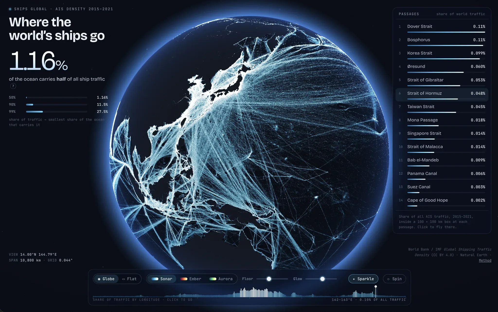
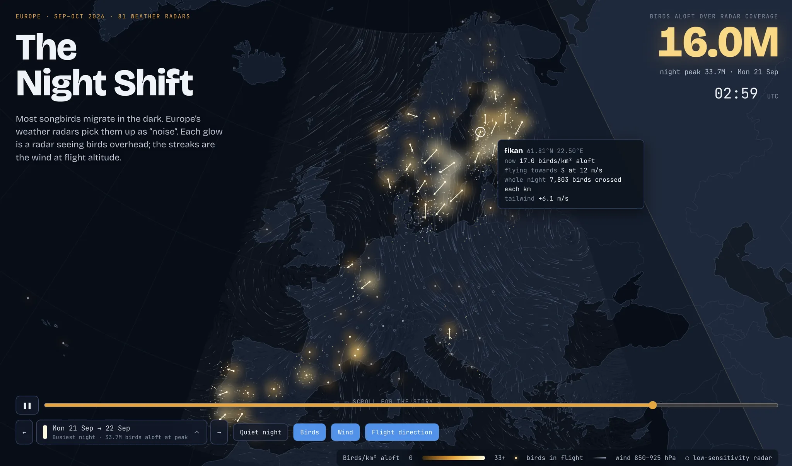
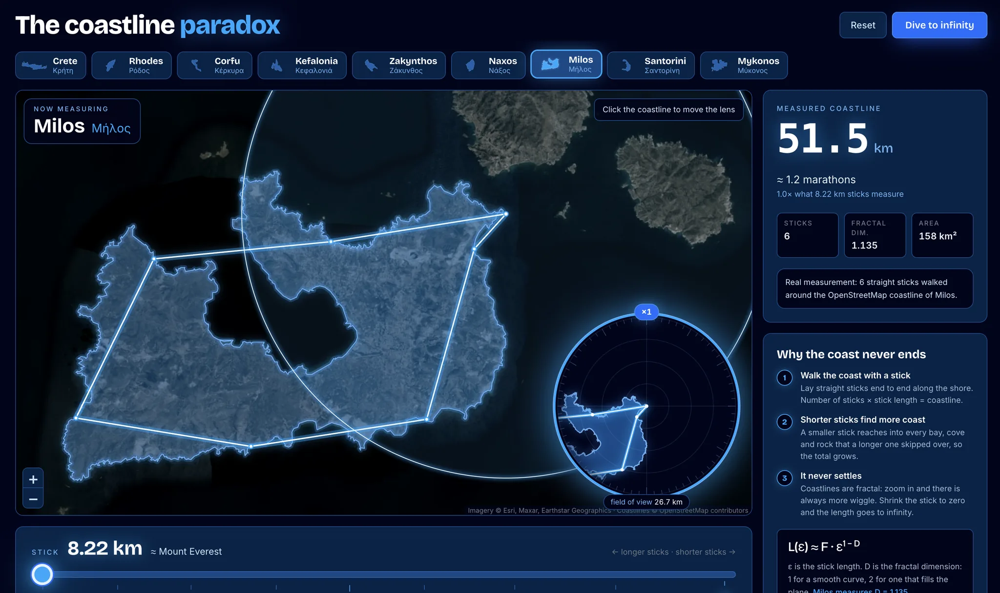

# Data app examples

Three [data app projects](https://deepnote.com/docs/data-app-projects) built on public data. Each folder is one project: a notebook that downloads and prepares the data, and a hand-written page in `_deepnote_static/` that shows it.

The data isn't in this repo. Each notebook downloads its own data on the first run and caches it in the project, so later runs are fast.

| Example                                      | What it shows                                                                                             | Data                                                                                                                                                                         | First run                     |
| -------------------------------------------- | --------------------------------------------------------------------------------------------------------- | ---------------------------------------------------------------------------------------------------------------------------------------------------------------------------- | ----------------------------- |
| [Global ship traffic](./ship-traffic-globe)  | A 3D globe and flat map of six years of global shipping lanes, with the busiest straits and canals        | [World Bank / IMF Global Shipping Traffic Density](https://datacatalog.worldbank.org/search/dataset/0037580) (CC BY 4.0), [Natural Earth](https://www.naturalearthdata.com/) | About 20 min, 535 MB download |
| [The Night Shift](./bird-migration-europe)   | Nightly bird migration over Europe in autumn 2026, measured by weather radars, and how the wind shapes it | [Aloft](https://aloftdata.eu/) radar profiles (CC BY 4.0), ECMWF IFS wind via [Open-Meteo](https://open-meteo.com/)                                                          | About 20 min, 3 GB download   |
| [The coastline paradox](./coastline-paradox) | Why a coastline gets longer the shorter your ruler is, measured on nine Greek islands                     | [OpenStreetMap](https://www.openstreetmap.org/copyright) via Nominatim                                                                                                       | Under a minute                |

No API keys are needed.

## What they look like

**[Global ship traffic](./ship-traffic-globe)**

**[The Night Shift](./bird-migration-europe)**

**[The coastline paradox](./coastline-paradox)**

## Run one

1. In Deepnote, create a new data app project.
2. Upload the example's `.deepnote` notebook and the rest of its folder (`_deepnote_static/`, and `birds/` for The Night Shift) to the project files.
3. Run the notebook. It writes the app's data, and the app shows it.

The Night Shift builds its whole page from `birds/app_template.html`, so its `_deepnote_static/index.html` only appears after the first run.
